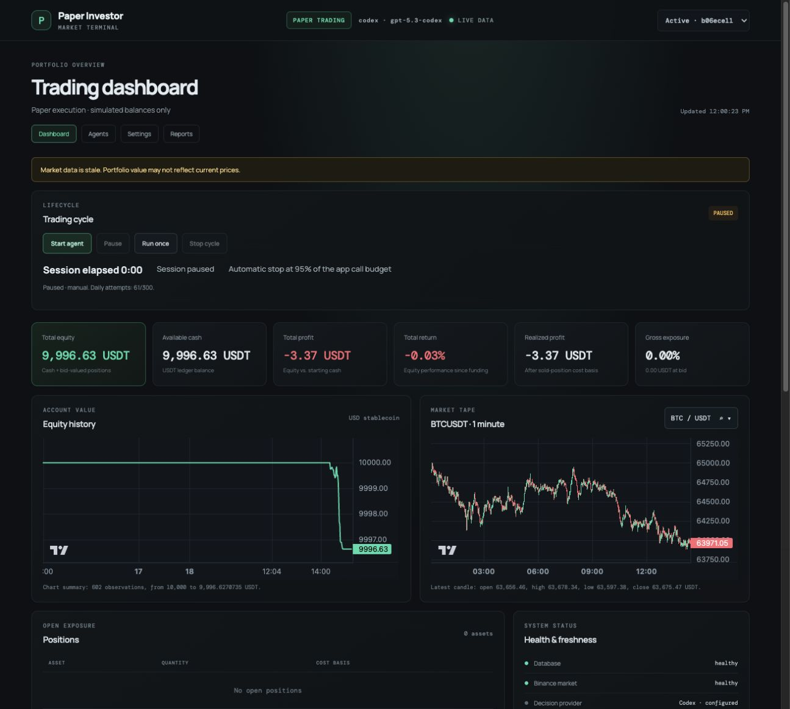

# Paper Crypto Investor

**An AI trading team with independent perspectives, visible collaboration, and an auditable decision history.**

Paper Crypto Investor brings multiple AI agents together to analyze live Binance spot data, challenge trade ideas, and manage a simulated crypto portfolio. Give each agent its own instructions, watch the discussion, and inspect the evidence behind every BUY, SELL, or HOLD.

Powered by the **OpenAI Responses API** or **xAI/Grok**, with configurable prompts, continuous trading sessions, and saved reports for future strategy analysis. All orders and balances are simulated; there is no live trading adapter.



*Actual local paper-trading session, paused. Figures are sample results; the dashboard also surfaces stale market data.*

## Your AI trading team

Five starter agents bring different responsibilities to one portfolio:

- **Trading Lead** coordinates the discussion and submits the final trading decision.
- **Market Analyst** evaluates prices, liquidity, and uncertainty in the supplied market data.
- **Momentum Analyst** examines momentum using the available price evidence.
- **Risk Analyst** checks exposure, liquidity, and configured risk limits.
- **Skeptic** challenges proposals, missing evidence, and downside assumptions.

Each agent has a separate, versioned prompt. In **Agents**, edit their instructions, add agents up to a ten-agent roster, disable or archive specialists, and assign an enabled agent as lead while the team is paused and idle. The selected provider and model apply to the entire team.

Team conversations, individual chats, and agent handoffs make collaboration visible. Chat is discussion-only: starting a trading session or choosing **Run once** authorizes an evaluation. Only the lead's final decision can reach paper execution.

### How AI becomes a trading decision

1. **Capture evidence.** Collect the portfolio, configured risk limits, live quotes, and up to 60 closed one-minute candles per configured asset. Unfinished and future candles are excluded.
2. **Collaborate.** Agents analyze the same evidence, share findings, and challenge proposals through bounded turns and handoffs.
3. **Finalize.** The lead submits a structured BUY, SELL, or HOLD decision, validated before execution.
4. **Enforce limits.** Deterministic checks enforce exposure, balance, liquidity, price freshness, and other execution constraints. Model output cannot bypass them.
5. **Save the outcome.** Persist the decision evidence, agent contributions, execution results, and trading costs for later analysis.

The harness supports up to five concurrent requests, with one turn per agent at a time. Each run is limited to 20 model calls and three minutes; individual requests have a one-minute timeout. A five-agent evaluation uses at least six calls, including lead finalization.

**OpenAI integration:** the provider labeled Codex uses the OpenAI Responses API with `gpt-5.3-codex` by default. It does not launch the Codex CLI or read its credentials. API keys stay on the server. Agent collaboration also supports xAI/Grok.

## Continuous trading, visible controls

Start a session from **Dashboard** or **Agents**. The next evaluation starts after the previous one completes, without a fixed five-minute interval. Each evaluation can trade or hold according to its evidence and risk checks.

The dashboard shows session elapsed time and running or paused status, with **Start**, **Pause**, **Run once**, and **Stop cycle** controls. Sessions continue until manually stopped or interrupted by a guardrail, such as the call-budget cutoff, daily loss limit, repeated provider failures, or a server restart. Market ingestion and portfolio valuation continue while trading is paused.

### AI usage and budget

The Agents usage bar measures a **configurable app model-call allowance**, shared across agents, simulations, and providers. The default is 300 calls per UTC day, with an automatic stop at 95% (285 calls). Failed attempts count, and resetting a portfolio does not reset usage.

This is not OpenAI account usage, a Codex subscription quota, or a dollar balance. OpenAI billing, token usage, and API charges are not currently tracked in the reports. Model calls can incur real API charges independently of simulated trading funds.

## Explore the platform

- **Dashboard:** monitor equity, available cash, profit, exposure, positions, recent trades, fees, agent activity, and service health. Browse Binance USDT spot markets with candle charts, including markets outside the trading watchlist. Failed dashboard reads retry automatically.
- **Agents:** manage the roster and versioned prompts, inspect conversations and handoffs, chat with individual agents, and monitor the daily call allowance.
- **Settings:** choose the AI provider, model, markets, strategy, risk limits, trading fees, slippage, and call budget. Set initial virtual funding or reset into a new simulation while preserving archived history.
- **Reports:** filter saved evaluations by date, browse active or archived simulations, download JSON evidence, and delete or restore reports without changing trades or balances.

Navigation always follows **Dashboard → Agents → Settings → Reports**. Chart selections and unsaved drafts survive navigation within the browser session; reloading clears unsaved drafts.

### Trading costs and risk controls

Paper fills use bid/ask prices, configured slippage, and a fee on every filled buy and sell. Fees affect cash, position cost basis, and realized sell profit, so results reflect entry and exit costs.

The configurable default fee is **0.35% per fill**, based on a two-exchange taker-fee sample. It is a simulation assumption, not a universal exchange fee; change it in Settings to match your intended venue and tier.

Default risk limits cap a buy at 10% of equity, one asset at 25%, total exposure at 50%, and daily equity loss at 5%. Decisions also face age, adverse-price-movement, quantity, minimum-notional, and liquidity checks. AI decisions can be rejected, and profitable outcomes are not guaranteed.

## Reports for future improvement

Every completed evaluation—including HOLD, rejected trades, and failures—produces a versioned JSON report stored in PostgreSQL. Reports retain:

- Market and portfolio snapshots, configuration, and versioned agent prompts.
- Individual agent turns, messages, and the final decision.
- Orders, fills, and ledger entries.
- Trading fees, turnover, realized sell profit, filled/rejected counts, and available model-call counts.

These records provide evidence for a future analyst or agent to compare strategies and recommend changes. **Automatic recommendations and self-modifying strategies are not implemented.** Reports do not attribute profit causally to an individual agent, and open buys are not treated as realized gains.

Missing reports are retried through a recovery job. Date filters use your local timezone and include the entire selected end date. Deletion hides a report and supports restoration; it preserves the original trading records. Back up PostgreSQL to preserve the archive outside this machine.

See the [execution and report reference](docs/execution-and-reports.md) for transaction guarantees, report schemas, API endpoints, and historical-data limitations.

## Run locally

### Requirements

- macOS or Linux
- Node.js 24.11.1 (see `.node-version`)
- pnpm 10
- Docker with Docker Compose
- An OpenAI API key or an xAI API key

```sh
pnpm install
cp .env.example .env
```

Set `OPENAI_API_KEY` for Codex or `XAI_API_KEY` for Grok in `.env`. The server reads this file at startup. Keep `.env` private; Git ignores it.

```sh
pnpm db:up
pnpm db:migrate
pnpm dev
```

Open [http://127.0.0.1:5173](http://127.0.0.1:5173). The API binds to `127.0.0.1:3000`.

1. Open **Settings**, choose your starting virtual USDT balance, and configure the provider, model, markets, fees, and risk limits.
2. Open **Agents** to review the team and its prompts.
3. Choose **Run once** for one evaluation, or start a continuous session.
4. Follow decisions on the dashboard and download the resulting evidence from **Reports**.

Save strategy and team changes while trading is paused and idle. Starting funds stay fixed for each simulation; reset to choose a new balance. Reset retains the roster, prompts, and settings in a new simulation, while previous conversations remain in the archive. Server restarts preserve stored history and leave interrupted trading stopped.

To stop PostgreSQL, run `pnpm db:down`; its Docker volume is retained.

### Environment

- `HOST`: `127.0.0.1`. Other bind addresses are rejected.
- `PORT`: `3000` by default.
- `DATABASE_URL`: local PostgreSQL connection; see `.env.example`.
- `OPENAI_API_KEY`: server-side OpenAI credential.
- `XAI_API_KEY`: server-side xAI credential.

The app is designed for local use. API access is same-origin, and mutations require an explicit same-origin JSON request. Do not expose it to a public network.

## Stack

TypeScript throughout, with React and Vite for the interface, Fastify for the API, PostgreSQL and Drizzle for persistence, the Vercel AI SDK for model integration, Zod for validation, Decimal.js for financial calculations, and Lightweight Charts for market visualization.

## Smoke checks

These checks never submit orders:

```sh
pnpm smoke:binance
pnpm smoke:grok
pnpm smoke:codex
```

- `smoke:binance` makes bounded public REST requests for exchange instruments, one BTC/USDT quote, and recent one-minute candles.
- `smoke:grok` sends at most one validated decision request using the active simulation and fresh quotes, then discards the decision. It requires `XAI_API_KEY`, a migrated database, and a running app to populate market data. Without a key, it reports a skip without sending a request. The request has a 30-second deadline.
- `smoke:codex` sends one real Codex API request with synthetic data and no market quotes, validates a hold decision, and discards it. It requires `OPENAI_API_KEY`, has a 30-second deadline, and needs no database or running app. Missing credentials or a failed request exit unsuccessfully. This standalone connectivity check does not update the simulation usage ledger.

The smoke scripts print request results and decisions without printing credentials, prompts, or portfolio snapshots.

## Validation

Start Docker first, then use the isolated test database:

```sh
pnpm db:up
pnpm db:migrate:test
pnpm test:unit
pnpm test:integration
pnpm test:e2e
pnpm typecheck
pnpm lint
pnpm build
```

See [docs/validation.md](docs/validation.md) for coverage and system validation details. Integration tests truncate data in `paper_investor_test`; they do not use the application database.
